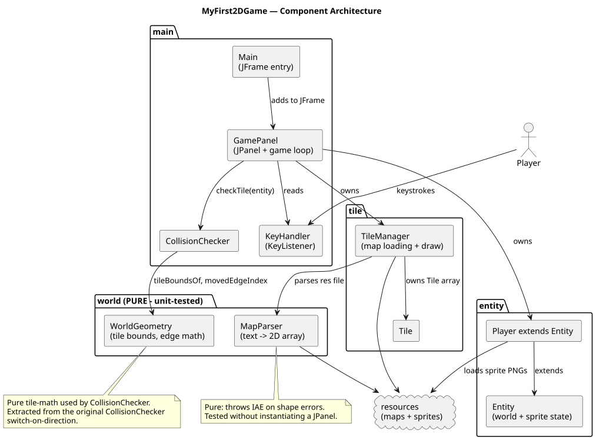
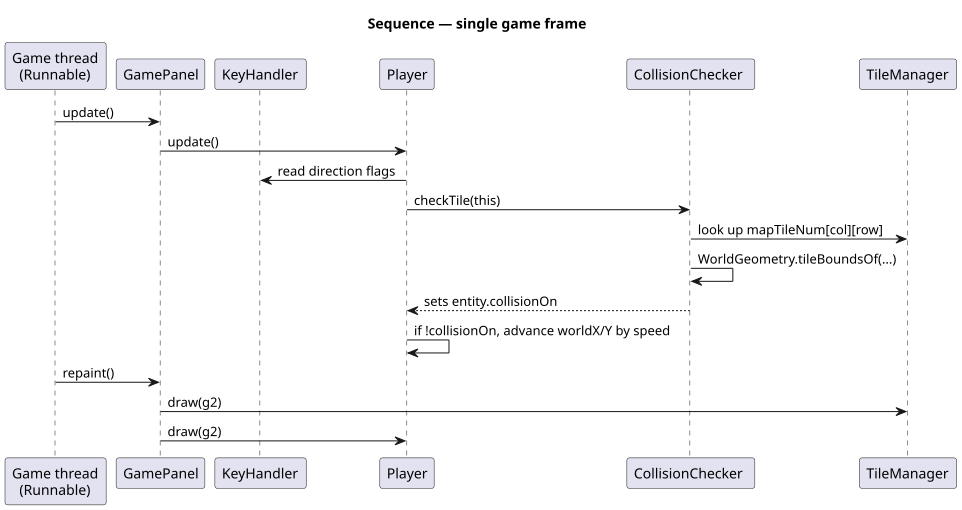
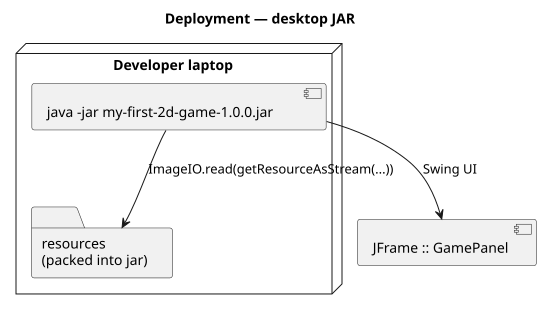

# MyFirst2DGame

Top-down 2D adventure game built with Swing/AWT. Move a sprite around a
tile-based world with collision detection.

[](https://github.com/tzone85/MyFirst2DGame/actions/workflows/ci.yml)


Was an IntelliJ-only project (no `pom.xml`/`build.gradle`, ran from the IDE).
This rewrite adds a real Maven build, extracts pure helpers from the
Swing-coupled logic, and ships JUnit 5 + JaCoCo + GitHub Actions.

## What changed during the port

- **Maven layout** — moved `src/` to `src/main/java/{main,entity,tile,world}`
  and `res/` to `src/main/resources/`. Now buildable with `mvn package`.
- **Extracted pure helpers** to `src/main/java/world/`:
  - `MapParser` — parses a tile-grid text file into `int[][]`. Throws
    `IllegalArgumentException` on shape errors instead of swallowing them
    in a bare `try/catch (Exception e) {}` like the original
    `TileManager.loadMap`.
  - `WorldGeometry` — tile-bound math used by `CollisionChecker`, lifted
    out of the switch-on-direction in the original.
- **JUnit 5** tests for the pure helpers (16 tests, 100% line coverage on `world`).
- **JaCoCo** with a coverage gate of 90% lines / 85% branches on the `world` package.
- **GitHub Actions** workflow: `mvn -B -ntp verify` + JaCoCo report uploaded.
- Removed the `MyFirst2DGame.iml` / `.idea/` artefacts — IDE-agnostic now.

## Architecture







Diagrams are PlantUML under `docs/architecture/*.puml`; rendered SVGs are
checked in. Regenerate with `./scripts/render_diagrams.sh` (requires
`plantuml` on `PATH`).

## Build + run

```
mvn -B -ntp verify                   # compile, test, JaCoCo coverage gate
mvn -q exec:java -Dexec.mainClass=main.Main   # run from source

# Or as a fat jar:
mvn -q package
java -jar target/my-first-2d-game-1.0.0.jar
```

Maven is the only requirement at the host level — Java 21 (Temurin) is what
CI uses.

## Project layout

```
src/main/java/
├── main/        # Main, GamePanel, CollisionChecker, KeyHandler
├── entity/      # Entity, Player
├── tile/        # Tile, TileManager
└── world/       # PURE: MapParser, WorldGeometry (unit-tested)
src/main/resources/
├── maps/        # gameMap1, gameMap2, world01 (tile-id grids)
├── player/      # 8 walking-frame PNGs
└── tiles/       # earth, grass, water, tree, wall, sand PNGs
src/test/java/world/      # JUnit 5 tests for the pure helpers
docs/architecture/        # PlantUML + SVGs
.github/workflows/ci.yml
pom.xml
```

## Tests

| Suite                            | Count   | What                                                                                |
|----------------------------------|---------|-------------------------------------------------------------------------------------|
| `world.MapParserTest`            | 8       | Rectangular grid parse, missing rows / cells, non-numeric, dimension validation, classpath read, missing-resource |
| `world.WorldGeometryTest`        | 8       | `tileBoundsOf` at origin and straddling, zero-tile-size guards, `movedEdgeIndex` in all four directions |
| **Total**                        | **16**  | 90% line / 85% branch JaCoCo gate on the `world` package                            |

## CI

Single job: `mvn -B -ntp verify` (compile → unit tests → JaCoCo report + gate). JaCoCo HTML report uploaded as a 14-day artifact.

## License

MIT — see [LICENSE](LICENSE).
